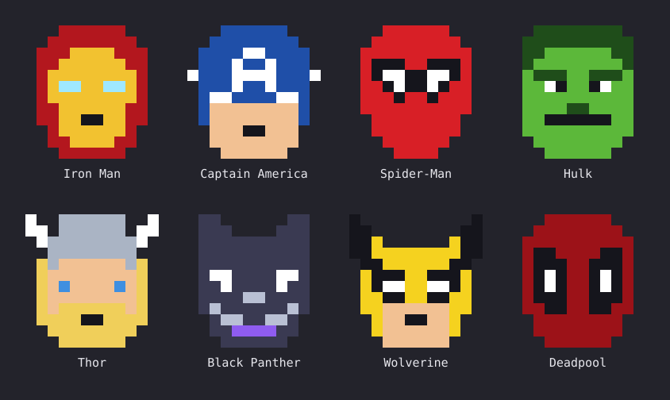

# claude-code-marvel-8bit

A [Claude Code](https://claude.com/claude-code) mod that replaces Claude's working mark with 8-bit superhero sprites.



Iron Man, Captain America, Spider-Man, Hulk, Thor, Black Panther, Wolverine and Deadpool. Each is a 12×12 sprite drawn in code (no image files), so the whole mod is a few hundred lines of TypeScript.

## Install

```bash
claude plugin marketplace add arjkul/claude-code-marvel-8bit
claude plugin install marvel-8bit@marvel-8bit
```

Start a new session and send a prompt. Turn it off with `claude plugin disable marvel-8bit@marvel-8bit`.

## Use

| Command | What it does |
| --- | --- |
| `/hero` | Show the current setting and the roster |
| `/hero thor` | Pin one hero (loose matching: `spider`, `panther`, `cap`) |
| `/hero shuffle` | Go back to rotating through all eight |

Your pin is remembered across sessions.

## How it works

It is a Claude Code *mod*: a plugin of function hooks that hook `ui.render` for the `Spinner` and running `ToolUse` components.

- **Terminal:** the sprite is a colored cell grid (half-block characters), with the working word beside it.
- **Desktop app:** the sprite is an SVG. In shuffle mode all eight heroes live in one self-animating image (one every 2.5 seconds), because the desktop app drops a custom mark as soon as the tree under it changes.

## Limits

- The hero shows on the working spinner and on running command rows. It does not appear on reply text or in hidden thinking blocks, and the app icon, sidebar logo and welcome logo are not exposed to mods.
- On the desktop, the step text next to the mark (such as "Running a command") is not shown in shuffle mode, for the reason above.
- The mod API is early access and may change between Claude Code releases. Built and tested on Claude Code 2.1.288.

## Develop

```bash
claude plugin validate plugins/marvel-8bit
claude plugin test plugins/marvel-8bit
```

## Disclaimer

Unofficial fan project. The sprites are original pixel-art interpretations of characters owned by Marvel. This project is not affiliated with, endorsed by or sponsored by Marvel, Disney or Anthropic. Marvel character names and likenesses belong to their owners; the MIT license covers the code only.
